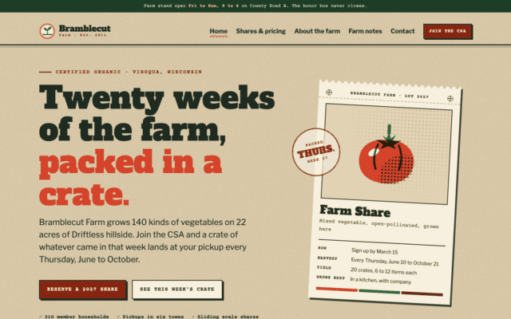

<p align="center"><!-- theme:hero --><!-- /theme:hero --></p>

<!-- theme:title --><h1 align="center">Bramblecut</h1><!-- /theme:title -->

<p align="center"><!-- theme:tagline -->A small organic farm: CSA farm-share boxes, farm stand, farm dinners<!-- /theme:tagline --></p>

<!-- theme:badges -->
<p align="center">
  <a href="https://dreamr-design.github.io/dreamr-web/themes/farm-csa/preview"></a>
  <a href="https://github.com/dreamr-design/farm-csa-design"></a>
  
  <a href="LICENSE.md"></a>
  <a href="https://dreamr-design.github.io/dreamr-web"></a>
</p>
<!-- /theme:badges -->

Bramblecut Farm, a fictional five-person certified organic vegetable farm on 22 acres of Driftless hillside near Viroqua, Wisconsin. It sells a twenty-week CSA (the Stand Card, Half, Full and Kitchen shares, with pay-in-4 and sliding-scale options), runs an honor-box farm stand, and hosts four farm dinners a year at one long table in the squash field. The whole site is dressed as seed packets and produce crates, printed in two inks on kraft.

Live demo: https://dreamr-design.github.io/dreamr-web/themes/farm-csa/preview

Source repo: https://github.com/dreamr-design/farm-csa-design

<!-- theme:callout -->

> [!NOTE]
> This theme is free to use on any site, personal or commercial. The "Free theme by Dreamr" credit in the footer stays; to remove it, get a [credit-removal license](https://dreamr-design.github.io/dreamr-web/license).

<!-- /theme:callout -->

## Quick start

The Bramblecut design with no site code. [DESIGN.md](DESIGN.md) describes it in words, and [theme.json](theme.json) holds its palette and type as data. Put both in your project, then paste this prompt into your AI assistant:

```text
Read DESIGN.md and theme.json in this folder before you write any code. They describe the Bramblecut theme: its palette, type, spacing, components and voice. Build every page I ask for in that design. Use only the colors and fonts they name, reuse the components they describe, and match the tone of their copy. If a page needs something they do not cover, extend the design in the same spirit and tell me what you added.
```

## Contents

- [Pages](#pages)
- [Settings](#settings)
- [Built-in services](#built-in-services)
- [Design DNA](#design-dna)
- [Fonts](#fonts)
- [License](#license)

## Pages

- `/` Bramblecut Farm
- `/pricing/` Shares and pricing
- `/about/` About the farm
- `/contact/` Write to the farm
- `/blog/` Farm notes

## Settings

- `chatsy_agent_id`: Chatsy agent id. Create a free AI chat agent at https://chatsy.ai, paste its id here, and a chat button appears on every page. Leave empty for no chat button.
- `slapform_form_id`: Slapform form id. Create a free form at https://slapform.com and paste its id here; every form on the site then delivers to your inbox with spam protection.

## Built-in services

### AI chat with Chatsy

Set `chatsy_agent_id` and a chat button in the theme's accent color appears on every page. Create an agent free at [chatsy.ai](https://chatsy.ai): it answers visitors from your own knowledge base.

### Working forms with Slapform

Set `slapform_form_id` and every form on the site (index, pricing, contact) delivers to your inbox. Create a form free at [slapform.com](https://slapform.com); no server needed. A form's `data-slapform-success` attribute sets its thank-you text.

## Design DNA

[DESIGN.md](DESIGN.md) describes the palette, type, spacing and signature moves so a designer or an AI assistant can extend the site in the same voice.

## Fonts

Google Fonts: Alfa Slab One, Courier Prime, Libre Franklin, Stardos Stencil.

## License

The `free` license: use it on any site and keep the footer credit. See `LICENSE.md`.

---

A free theme by [Dreamr](https://dreamr-design.github.io/dreamr-web). More themes: https://dreamr-design.github.io/dreamr-web
